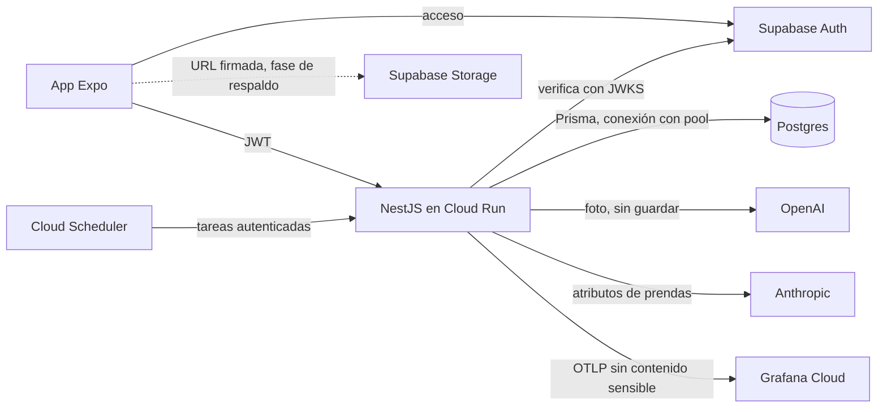

# Plan del backend público

9/11/2026 · Plan, sin despliegue ni servicios contratados. Hoy el proxy solo escucha en loopback y la build de tienda no tiene URL de análisis.

**Actualización del 11/11/2026:** las fases 1 a 3 están implementadas del lado del servidor en el repositorio `arma-tu-outfit-api` y probadas en local ([ADR-011](adr/0011-backend-publico-con-cuentas-opcionales.md)). La fase 3 usa un proveedor simulado y el adaptador de OpenRouter de la fase 4 está escrito y probado sin red: no hubo ninguna llamada real. Faltan staging, las claves, el proyecto de Supabase, la revocación de Apple y los cambios en la app. La fase 0 sigue pendiente.

Sustituye la versión anterior de este documento, que proponía identidad anónima, Firestore y un servidor mínimo, porque el objetivo pasó a incluir un posible marketplace. Las decisiones están registradas en [la sección 10](#10-decisiones).

Cada dato lleva su origen: **Fuente** (documentación oficial consultada el 9/11/2026), **Medido** (ejecutado sobre el código), **Tabe** (leído en el repositorio `tabe-api` del mismo titular) o **Supuesto** (estimación por comprobar). Este plan no es asesoría legal ni fiscal.

## Resumen

| Tema | Recomendación |
|---|---|
| Stack | NestJS, Prisma y Postgres, con las mismas reglas de ingeniería de `tabe-api`. |
| Cuentas | Opcionales. El clóset funciona sin registro; la cuenta se pide para lo que vive en la nube: IA, respaldo y marketplace. |
| Identidad | Supabase Auth con Apple, Google y código por correo. NestJS verifica el JWT y autoriza con su propia base. |
| Alojamiento | Contenedor Docker en Cloud Run, separado del VPS de Tabe. Postgres y Storage en Supabase. |
| Forma | Monolito modular. El marketplace se prepara con decisiones de modelo, no con tablas ni código anticipados. |
| IA | OpenAI (GPT-6 Luna) para analizar fotos y Claude Sonnet 5.5 para elegir outfit. |
| Costo fijo | Unos 25 USD al mes en producción, más la IA por uso. Tope de la beta: 20 USD al mes de IA. |

## 1. Alcance por etapas

| Etapa | Qué incluye | Qué desbloquea |
|---|---|---|
| A. App local | La app actual, sin backend. La IA aparece como «Ya casi…» en TestFlight y oculta en App Store. | Publicar sin esperar al servidor. |
| B. Base y cuentas | Repositorio NestJS, CI, Docker, staging, cuentas opcionales y borrado de cuenta. | Una base sobre la que crecer. |
| C. IA pública | Los dos endpoints actuales con permiso explícito, cuotas y tope de gasto. | Analizar fotos y elegir outfit en la tienda. |
| D. Respaldo y sincronización | Lo descrito en [cuentas y datos](cuentas-y-datos.md), con la API en lugar del acceso directo a Postgres. | Cambiar de teléfono sin perder el clóset. |
| E. Marketplace | Vendedores, publicaciones, pedidos y pagos. Se construye solo si hay uso y demanda comprobados. | Vender ropa propia y de tiendas. |

El recomendador sigue en el teléfono en todas las etapas. La IA solo propone y las reglas 1 a 7 de [AGENTS.md](../AGENTS.md) no cambian.

**Fuera de las etapas B y C:** tablas o código de marketplace, búsqueda, chat, moderación, pagos, tiempo real, colas y microservicios.

## 2. Cuentas

### Por qué ahora sí, y por qué opcionales

La versión anterior evitaba las cuentas porque nada las necesitaba. El marketplace y el respaldo sí las necesitan, y una identidad anónima por dispositivo tendría que migrarse después.

| Función | Sin cuenta | Con cuenta |
|---|---|---|
| Clóset, outfits, clima, historial | Sí | Sí |
| Análisis con IA | No | Sí, con cuota por persona |
| Respaldo y varios dispositivos | No | Sí |
| Comprar o vender | No | Sí |

**Fuente:** [5.1.1(v)](https://developer.apple.com/app-store/review/guidelines/#data-collection-and-storage) pide permitir el uso sin login si la app no tiene funciones significativas basadas en cuenta, y exige eliminar la cuenta dentro de la app si existe registro. La app sigue siendo útil sin registro y la cuenta solo se pide en funciones de nube. Es una lectura propia que App Review puede interpretar distinto; por eso conviene incluir la explicación en las notas de revisión.

Pedir cuenta para la IA elimina App Attest y Play Integrity de la primera versión: un módulo nativo, la verificación CBOR en servidor y dispositivos sin soporte. Quedan como refuerzo si aparece abuso ([sección 6](#6-límites-y-costo)).

### Cómo se implementa

| Pieza | Decisión | Origen |
|---|---|---|
| Proveedor | Supabase Auth. | **Tabe:** es lo que usa su API en producción. Su paso a Better Auth aún no ocurre y lo aloja su dashboard web, una pieza que aquí no existe. |
| Métodos | Sign in with Apple, Google y código por correo. | **Fuente:** [4.8](https://developer.apple.com/app-store/review/guidelines/#login-services) exige una opción equivalente al usar un login social. |
| Verificación | NestJS valida firma, algoritmo permitido, `issuer`, `audience`, `exp` y `sub` contra JWKS. | **Tabe:** mismo modelo, con `jose`. |
| Autorización | Se consulta la base. Los claims del JWT o del cliente nunca dan permisos. | **Tabe.** |
| Identificador | `users.id` es el UUID de Auth y es la llave de todo lo demás. | **Tabe:** permite cambiar de proveedor sin migrar datos. |
| Sesión en móvil | Adaptador sobre SecureStore, según [cuentas y datos](cuentas-y-datos.md#acceso-y-sesión). | Propuesta existente. |

### Eliminación de cuenta

Iniciada dentro de la app, con reautenticación. Bloquea nuevas operaciones, revoca sesiones y ejecuta un borrado reintentable. Con Sign in with Apple hay que [revocar los tokens](https://developer.apple.com/news/?id=12m75xbj). Desactivar no basta. Google pide además un [enlace web para solicitarla](https://support.google.com/googleplay/android-developer/answer/13327111). Cuando existan pedidos, estos se conservan anonimizados por obligación fiscal y el resto se borra.

## 3. Stack

| Capa | Elección | Respecto a Tabe |
|---|---|---|
| Runtime | Node LTS en contenedor Docker multi-etapa que corre las pruebas durante la build. | Igual |
| Framework | NestJS con módulos verticales y `ValidationPipe` estricto. | Igual |
| Datos | Postgres en Supabase con Prisma y `@prisma/adapter-pg`. `DATABASE_URL` con pool y `DIRECT_URL` para migraciones. | Igual |
| Fotos | Supabase Storage con URLs firmadas. | Igual, con la excepción de la [sección 7](#recorrido-de-la-foto) |
| Secretos | Google Secret Manager, inyectados como variables. | Distinto: Tabe usa el entorno de Dokploy |
| Observabilidad | OpenTelemetry a Grafana Cloud, con una lista cerrada de campos. | Igual, más estricta con el contenido |
| IA | Registro de proveedores detrás de una interfaz común. | Igual |
| Pagos (etapa E) | Registro de proveedores; Mercado Pago marketplace primero. | Igual |
| Cómputo | Cloud Run. | Distinto, ver abajo |

### Por qué Cloud Run y no el VPS de Tabe

**Tabe:** producción, staging y desarrollo comparten un VPS de 2 vCPU y 8 GB, y su documentación registra que ya se quedó sin memoria. Otro servicio ahí arriesga a ambos productos.

**Fuente:** Cloud Run [escala a cero por defecto y admite cuerpos HTTP/1 de hasta 32 MiB](https://docs.cloud.google.com/run/quotas). Como todo va en Docker, mudarse a un VPS propio o a otro proveedor solo cambia el destino del despliegue.

**Consecuencias:** al escalar a cero no sirve `@nestjs/schedule`, así que las tareas periódicas llegan por Cloud Scheduler a rutas autenticadas. Las migraciones corren como paso previo del despliegue, igual que en el flujo de staging de Tabe; un fallo cancela la publicación.

### Módulos

Etapas B y C: `auth`, `users`, `consents`, `ai`, `usage` y `status`. Etapa D: `closet-sync` y `media`. Etapa E: `sellers`, `listings`, `orders`, `payments` y `moderation`.

Controladores que solo enrutan, servicios con la lógica, repositorios como únicos dueños de las consultas Prisma. Un servicio nunca inyecta el repositorio de otro módulo; los efectos entre módulos van por eventos de dominio.

## 4. Datos

### Tablas de las etapas B y C

| Tabla | Contenido | Clase de retención |
|---|---|---|
| `users` | UUID de Auth, fechas, estado de eliminación. | Personal |
| `ai_consents` | Persona, proveedor, función, fecha de otorgamiento y de retiro. | Personal |
| `ai_usage` | Persona, función, periodo, usados y reservados. Único por los tres primeros. | Operativa |
| `ai_spend` | Día, reservado y real en microdólares. | Operativa |
| `idempotency_keys` | Persona, clave, hash del cuerpo, estado y caducidad. | Operativa |

Las etapas D y E añaden las entidades de [cuentas y datos](cuentas-y-datos.md#modelo-de-datos-inicial) y las de la [sección 5](#5-preparación-para-el-marketplace).

### Reglas de la base de datos

**Acceso**

1. La app nunca se conecta a Postgres. Solo NestJS lo hace. Esto sustituye el acceso directo con RLS de [cuentas y datos](cuentas-y-datos.md#propiedad-y-fotos).
2. RLS activado y sin políticas para `anon` ni `authenticated`, como defensa por si alguna tabla queda expuesta por la API de datos de Supabase.
3. Dos roles: el de ejecución con permisos por tabla y el de migraciones, usado solo por `DIRECT_URL`. **Tabe:** cada tabla nueva lleva `GRANT` explícitos.
4. El propietario sale siempre del token verificado, nunca del cuerpo. Las referencias incluyen `user_id` en la llave foránea para impedir cruces entre personas.

**Qué nunca entra**

5. Bytes de imagen, resultados de analizar una foto, selfies, tono de colorimetría, IP, tokens, URLs firmadas ni contraseñas. El tono se queda en el teléfono; sincronizarlo exigiría una decisión aparte.

**Retención por clase**

6. Esta regla difiere de Tabe a propósito: allá todo es borrado lógico porque casi todo son datos de negocio.

| Clase | Ejemplos | Regla |
|---|---|---|
| Comercial | Publicaciones, pedidos, pagos | Sin permiso `DELETE`, con `deleted_at` y unicidad parcial `WHERE deleted_at IS NULL`, como en Tabe. |
| Personal | Cuenta, clóset, fotos, permisos | Borrado real al eliminar la cuenta, con una tarea que usa un rol propio. Las marcas de sincronización caducan. |
| Operativa | Cuotas, gasto, claves de idempotencia | Borrado real por caducidad. |

**Integridad**

7. Cuotas y gasto en una sola sentencia atómica: reservar antes de llamar a la IA con `UPDATE … WHERE usados + reservados < límite`, y ajustar después con el consumo real.
8. `Idempotency-Key` única por persona. Un reintento devuelve el resultado anterior o un conflicto y nunca vuelve a cobrar.
9. Dinero en enteros de la unidad menor, con moneda explícita. El libro de movimientos solo admite inserciones y tiene un único escritor. **Tabe:** misma regla en pagos.
10. UUID con `gen_random_uuid()`, fechas en `TIMESTAMPTZ` y un índice por cada llave foránea y propietario.

**Migraciones**

11. Idempotentes y compatibles con la versión anterior, comprobadas en CI con un verificador como el `migration-checker` de Tabe. La versión anterior sigue atendiendo mientras la nueva ya está aplicada.

## 5. Preparación para el marketplace

Estas decisiones son caras de cambiar después y baratas de tomar ahora. Se aplican al modelar las etapas B a D, sin crear tablas de marketplace antes de tiempo.

1. **Cuenta y vendedor son cosas distintas.** Un `seller` puede ser una persona o una tienda con varios miembros, y las publicaciones pertenecen al `seller`. Así caben usuarios y tiendas sin duplicar nada.
2. **El clóset y lo que se vende están separados.** `wardrobe_items` es privado y `listings` es público, con sus propias fotos, precio y estado. Publicar crea una copia y nunca expone el clóset. El [roadmap](../ROADMAP.md) ya pide no mezclar compras con el inventario propio.
3. **Pagos independientes del proveedor.** Interfaz de dominio, adaptadores y máquina de estados, como `src/modules/payments` en Tabe.
4. **La app no retiene dinero.** Cada vendedor conecta su cuenta y la app cobra una comisión. **Tabe:** mismo modelo.
5. **Fotos públicas y privadas en buckets distintos**, para que una foto del clóset nunca pueda quedar pública por un error de permisos.

### Lo que el marketplace exigirá

| Tema | Requisito | Origen |
|---|---|---|
| Contenido de usuarios | Filtrar contenido inaceptable, reportar con respuesta oportuna, bloquear usuarios y publicar un contacto. | **Fuente:** [1.2](https://developer.apple.com/app-store/review/guidelines/#user-generated-content) |
| Compra dentro de la app | Los bienes físicos no usan compra integrada; se cobran con otros medios. | **Fuente:** [3.1.3(e)](https://developer.apple.com/app-store/review/guidelines/#other-purchase-methods) |
| Mercado Pago | Cada vendedor autoriza por OAuth y necesita KYC nivel 6. La comisión del marketplace se aplica después de la de Mercado Pago. | **Fuente:** [Split de pagos](https://www.mercadopago.com.mx/developers/en/docs/split-payments/split-1-1/integration-configuration/integrate-marketplace) |
| API de cobro | La documentación usa `/v1/payments` en Checkout API, pero Tabe solo permite su Orders API. Resolverlo antes de implementar. | **Fuente** y **Tabe** |
| Impuestos en México | Las plataformas pueden tener obligaciones de retención de ISR e IVA y de reportar al SAT. Las fuentes consultadas no coinciden en la tasa vigente, y no se revisó si aplica cuando la app no recibe el dinero. | Consultar con un contador antes de la etapa E |
| Operación | Disputas, devoluciones, fraude y soporte. | **Supuesto:** trabajo sin automatizar al inicio |
| Producto | Vender más ropa contradice ayudar a usar la que ya se tiene. Empezar por revender ropa propia reduce ese conflicto. | [Roadmap](../ROADMAP.md#capacidades-opcionales) |

## 6. Límites y costo

### Límites propuestos

Son **supuestos** de partida; ajustarlos con datos de la beta.

| Límite | Hoy, en loopback | Primera versión |
|---|---|---|
| Análisis de prendas por persona | Sin distinción | 30 al día, 150 al mes |
| Elección de outfit por persona | Sin distinción | 10 al día, 100 al mes |
| Ritmo por persona | 6 por minuto, global | 6 por minuto |
| Tamaño de imagen | 4 MiB | 1.5 MiB, tras reducirla en el cliente |

Las respuestas 429 llevan `Retry-After` y un mensaje que remite al alta manual. Con el presupuesto agotado responde 503 y `/api/status` apaga la función.

### Tres topes de gasto

1. **En la aplicación:** reserva en `ai_spend` antes de llamar. Es el único que actúa antes de gastar y el freno real ante cuentas creadas en masa.
2. **En el proveedor:** límite de gasto en la cuenta de OpenRouter, por configurar en la fase 4. (Hasta el 11/11/2026 este punto preveía límites en las cuentas de OpenAI y Anthropic; ver la decisión 6.)
3. **En la nube:** `max-instances` y [presupuesto con tope](https://docs.cloud.google.com/billing/docs/how-to/budgets-spend-caps). Un presupuesto normal [solo avisa](https://docs.cloud.google.com/billing/docs/how-to/budgets).

Si el abuso supera estos topes, se exige correo verificado o se añade [`@expo/app-integrity`](https://docs.expo.dev/versions/latest/sdk/app-integrity/).

### Costo fijo

| Concepto | Costo | Origen |
|---|---|---|
| Supabase Pro | 25 USD al mes, con 10 USD de cómputo y respaldos diarios de 7 días. | **Fuente:** [precios](https://supabase.com/pricing) |
| Supabase Free | 0 USD, solo para desarrollo: [se pausa tras poca actividad en 7 días](https://supabase.com/docs/guides/platform/free-project-pausing). | **Fuente** |
| Cloud Run | Cerca de 0 USD dentro de la [capa gratuita](https://cloud.google.com/run/pricing). | **Supuesto** hasta medir arranque y uso |
| Correo y dominio | Por cotizar. | **Supuesto** |

Staging puede usar Supabase Free con actividad regular, o una segunda instancia de pago si la pausa estorba.

### Costo de IA

Estimado, **sin ninguna llamada real**. **Fuente:** [GPT-6 Luna](https://developers.openai.com/api/docs/models/gpt-6-luna) cuesta 0.10 USD por millón de tokens de entrada y 0.50 de salida; [Claude Sonnet 5.5](https://platform.claude.com/docs/en/models/sonnet-5-5/overview), 2 y 10; [Claude Opus 5.5](https://platform.claude.com/docs/en/models/opus-5-5/overview), 4 y 20. **Supuestos:** el multiplicador de imagen 1.2 de GPT-5.6 Luna, y 1 450 tokens de entrada y 200 de salida en una elección típica.

| Caso | USD |
|---|---|
| Foto de 12 MP como se envía hoy, con Luna | 0.00153 |
| Foto reducida a 1600×1200 con `detail: high`, con Luna | **0.00032** |
| Elección de outfit con Sonnet 5.5, típica | **0.0049** |
| Elección de outfit con Sonnet 5.5, tope | 0.0166 |
| Elección de outfit con Opus 5.5, típica | 0.0098 |
| Elección de outfit con Opus 5.5, tope | 0.0332 |

| Escenario mensual (**Supuesto**) | Con Sonnet | Con Opus |
|---|---|---|
| Una persona en su primer mes: 40 prendas, 2 fotos propias, 30 elecciones | 0.16 USD | 0.31 USD |
| 100 personas en su primer mes | 16 USD | 31 USD |
| 100 personas que agotan su cuota, en el peor caso | 174 USD | 341 USD |

Con 100 personas, Sonnet cabe en el tope de 20 USD y Opus no. Elegir entre 2 y 5 outfits ya válidos es una tarea acotada, así que Opus solo se justifica si la fase 0 muestra una mejora clara. El modelo se cambia por configuración, sin tocar código.

**11/11/2026:** el titular eligió Opus 5.5 como predeterminado de ambas funciones (decisión 6). Las fotos con Opus cuestan bastante más que con Luna: unos 3 000 tokens de entrada por foto reducida a 4 USD por millón son cerca de 0.012 USD antes de la salida, frente a 0.00032 con Luna (**Supuesto** hasta la fase 0). Con el tope de 20 USD al mes, las funciones se pausan solas al agotarlo y la app conserva el alta manual.

### Escalabilidad

- El servidor no guarda estado, así que crece añadiendo instancias. **Fuente:** el [máximo por defecto es de 100 por proyecto y región](https://docs.cloud.google.com/run/quotas).
- Cada solicitud retiene la imagen en memoria, de modo que conviene una concurrencia menor a las [80 por defecto](https://docs.cloud.google.com/run/docs/about-instance-autoscaling). Propuesta: 8 por instancia y 3 instancias al inicio, para contener el gasto.
- El primer límite será el número de conexiones a Postgres, no el servidor. Regla: `instancias × tamaño del pool` debe caber en el pool de Supabase. Medirlo antes de subir `max-instances`.
- Después, según datos: más cómputo en Supabase, réplicas de lectura y colas para tareas lentas. Un módulo solo se extrae como servicio si lo justifica una medición.

## 7. Fotos y datos sensibles

### Fotos de personas

Ninguna foto de una persona llega al backend ni a un proveedor. La [política de uso de OpenAI](https://openai.com/es-419/policies/usage-policies/), en vigor desde el 20/11/2026, prohíbe la clasificación de personas por características personales, así que la colorimetría se hace en el teléfono y la decide la persona ([ADR-010](adr/0010-colorimetria-en-el-dispositivo.md)). `/api/person-style` se retiró.

### Recorrido de la foto

| Foto | Tratamiento |
|---|---|
| Prenda, etapa C | Se reduce, se retiran metadatos y pasa por la API en memoria. Sin disco, caché ni colas. Es la excepción que Tabe permite para fotos reducidas en el cliente. |
| Prenda, etapa D | Subida directa con URL firmada, y a OpenAI con una URL firmada de 5 minutos. **Tabe:** su regla general. |
| OpenAI, por defecto | `store: false`, pero los [registros de abuso se conservan hasta 30 días](https://developers.openai.com/api/docs/guides/your-data). Hay que decírselo a la persona. |
| OpenAI con ZDR | Sujeto a aprobación. Nunca prometer «retención cero» absoluta. |
| Por OpenRouter (11/11/2026) | La foto pasa por OpenRouter y luego por el proveedor que sirve el modelo. Se pide `data_collection: "deny"`, que excluye a quien guarda o entrena con los datos. La retención propia de OpenRouter no está documentada en lo consultado; revisarla antes de la fase 5 y declarar a ambos. |

### Registros

Lista cerrada: ruta, estado, código de error interno, duración, estado del proveedor, tokens y versión de la app. Nunca cuerpo, imagen, instrucciones, sugerencias, IP, JWT ni identificador de usuario en claro.

`APICallError` del AI SDK tiene `requestBodyValues`, que puede llevar la imagen: nunca registrar un error crudo. Cloud Run añade por su cuenta registros con IP; filtrarlos o darles retención mínima. Prueba obligatoria: una imagen sintética con una cadena única que no debe aparecer en ningún registro.

### Permisos y declaraciones

**Fuente:** [5.1.2(i)](https://developer.apple.com/app-store/review/guidelines/#data-use-and-sharing) exige revelar cuándo se comparten datos con una IA de terceros y obtener permiso explícito antes. Google [pide lo equivalente](https://support.google.com/googleplay/android-developer/answer/9888076).

| Flujo | Hoy | Antes de publicar |
|---|---|---|
| Foto de prenda | Aviso visible sin permiso aparte. | Permiso explícito la primera vez, revocable. |
| Elegir con IA | Solo en desarrollo. | Permiso que nombre al proveedor y diga qué se envía. |
| Textos | «Tus datos se quedan en tu teléfono». | Cambiarlo al activar la IA: deja de ser exacto para las fotos de prendas. |

| Dato | App Privacy (Apple) | Data safety (Google) |
|---|---|---|
| Correo e identificador de cuenta | Contact Info y User ID · funcionalidad · vinculado | Email e IDs · funcionalidad y gestión de cuenta |
| Foto de prenda | Photos or Videos · funcionalidad | Photos · recopilada · opcional |
| Atributos para elegir outfit | Other User Content | App activity u Other info |

Las fotos se declaran aunque el backend no las guarde, porque los 30 días de OpenAI superan las definiciones de dato efímero de [Apple](https://developer.apple.com/app-store/app-privacy-details/) y [Google](https://support.google.com/googleplay/android-developer/answer/10787469). La selfie de la colorimetría no se declara: nunca sale del dispositivo.

## 8. Prácticas de ingeniería

| Práctica de `tabe-api` | Decisión |
|---|---|
| Controlador, servicio y repositorio; eventos entre módulos | Se adopta |
| Validación estricta y rechazo de campos desconocidos | Se adopta |
| Arranque que falla con configuración insegura | Se adopta |
| CI en cada PR: lint, pruebas con cobertura y build | Se adopta |
| Cobertura mínima: 80 líneas y sentencias, 70 funciones y ramas | Se adopta |
| Repositorios probados contra Postgres real, sin simular Prisma | Se adopta |
| Pruebas de concurrencia | Se adopta, sobre todo para cuotas y gasto |
| Docker multi-etapa que ejecuta las pruebas | Se adopta |
| Migraciones idempotentes con verificador | Se adopta |
| `Idempotency-Key` en operaciones que cuestan o cobran | Se adopta |
| Denegaciones genéricas que no revelan el permiso requerido | Se adopta |
| Interruptores de apagado por función | Se adopta, con `/api/status` |
| Borrado lógico en todas las tablas | **No:** solo en la clase comercial |
| Producción y staging en la misma máquina | **No:** entornos separados |
| Migraciones en el arranque del contenedor | **No:** paso previo del despliegue |
| Tareas con `@nestjs/schedule` | **No:** Cloud Scheduler, por escalar a cero |

Los secretos nunca se versionan, ni siquiera en respaldos de `.env`. El CI incluye un escaneo de secretos.

## 9. Cliente y fases

### Cambios en el cliente

| Área | Cambio |
|---|---|
| Configuración | `EXPO_PUBLIC_AI_API_URL` por perfil en [eas.json](../eas.json). Exigir `https:` fuera de desarrollo en `resolveAiApiUrl` ([client.ts](../src/ai/client.ts)). |
| Cuenta | Pantalla de acceso solo al pedir una función de nube, y **Eliminar cuenta** en Mi estilo. Requiere build nueva para Apple y Google. |
| Disponibilidad | Consultar `/api/status`. Sin URL, sin sesión o con la función apagada se mantiene `ComingSoon` ([ui.tsx](../src/components/ui.tsx)) y el alta manual. |
| Solicitudes | Añadir JWT e `Idempotency-Key` en `postPhoto` y `chooseOutfit`. |
| Imagen | Reducir a 1600 px, re-codificar en JPEG y retirar EXIF. Requiere `expo-image-manipulator`, sin instalar; comprobar compatibilidad con SDK 58. |
| Errores | Código de cuota en `AiClientError` y respuesta a `Retry-After`. Siempre con salida manual. |
| `__DEV__` | Quitar la condición de **Elegir con IA** ([useAiOutfitChoice.ts](../src/hooks/useAiOutfitChoice.ts)) solo al publicar. |

### Fases

El [ADR-011](adr/0011-backend-publico-con-cuentas-opcionales.md) registra cuentas, alojamiento y límites, porque cambian una frontera del sistema. Las fotos de prueba son sintéticas o con licencia, nunca personales.

| Fase | Entrega | Criterio de salida |
|---|---|---|
| **0. Medición** | Titular y países, primera llamada real por endpoint y comparación de Sonnet con Opus en un conjunto fijo. | Tokens, latencia y calidad reales reemplazan los supuestos. |
| **1. Base** | Repositorio, módulos vacíos, CI, Docker, staging, observabilidad y `/api/status`. | Un PR sin pruebas falla. El despliegue a staging se cancela si falla una migración. |
| **2. Cuentas** | Auth, guardas, tabla `users`, eliminación de cuenta y acceso en la app. | Una persona no puede ver datos de otra. Eliminar borra todo y revoca Apple. Probado en iPhone físico. |
| **3. IA con proveedor simulado** | Endpoints portados, permisos, cuotas, gasto e idempotencia. | Sin sesión, 401. Cuota, 429. Cuerpo excesivo, 413. Presupuesto agotado, 503. Las pruebas de concurrencia no superan ninguna cuota. La cadena canaria no aparece en registros. |
| **4. Proveedor real en staging** | Clave propia con límite bajo y topes activos. | Costo por análisis no mayor al doble del estimado. p95 bajo 15 s con arranque en frío. Apagar una función tarda menos de un minuto. |
| **5. Privacidad y fichas** | Política pública, App Privacy, Data safety y textos de permiso. | Cada dato enviado por el código aparece en la política y en ambas fichas. |
| **6. Beta y publicación** | TestFlight con 5 a 20 personas y luego App Store, con backend encendido durante la revisión. | Una semana sin contenido en registros y con gasto dentro del tope. Activar prendas y luego elección. |
| **7. Respaldo** | Etapa D, según [cuentas y datos](cuentas-y-datos.md#orden-de-implementación-y-aceptación). | Restauración en un segundo teléfono sin pérdida. |
| **8. Marketplace** | Etapa E, solo con demanda observada. | Decisión documentada, revisión fiscal y moderación operando antes del primer pago real. |

Una exportación no acredita ningún punto de iOS o Android: cada recorrido nativo se prueba en dispositivo y se registra en [la evaluación](evaluacion.md).

## 10. Decisiones

Aceptadas por el titular el 9/11/2026, salvo la 8.

| # | Decisión | Estado |
|---|---|---|
| 1 | **Foto de persona.** | No se envía a ningún proveedor ni se consulta a OpenAI. La colorimetría se hace en el dispositivo ([ADR-010](adr/0010-colorimetria-en-el-dispositivo.md)). |
| 2 | **Métodos de acceso.** | Apple y Google. Código por correo solo si hace falta, porque añade SMTP. |
| 3 | **Repositorio.** | Aparte, como `tabe-api`, con el contrato publicado por OpenAPI. |
| 4 | **Alojamiento.** | Cloud Run. |
| 5 | **Tope de gasto de IA en la beta.** | 20 USD al mes y 2 USD al día. |
| 6 | **Modelo para elegir outfit.** | Claude Sonnet 5.5 como predeterminado y Opus 5.5 como alternativa si la fase 0 muestra una mejora clara. **Cambiada el 11/11/2026:** ambas funciones usan OpenRouter en lugar de las API directas, para no depender de un proveedor y elegir el modelo por configuración, y Claude Opus 5.5 es el predeterminado de las dos, también para analizar fotos. Obliga a declarar a OpenRouter como intermediario y, con el tope de la decisión 5, alcanza para menos personas (sección 6). |
| 7 | **Android.** | Después de validar iOS. |
| 8 | **Titular, países y contacto de privacidad.** | **Pendiente.** Con UE o Reino Unido, revisión legal antes de la fase 5. |
| 9 | **Primer marketplace, cuando llegue.** | Reventa entre personas, por encajar mejor con la idea del producto. |

## Sin verificar

- Ninguna llamada real a OpenAI ni a Anthropic; todos los costos de modelo son estimados.
- Tamaño del pool de Supabase y conexiones por instancia, arranque en frío de NestJS con Prisma en Cloud Run y precios de Google Secret Manager y Cloud Scheduler.
- Flujo nativo de Apple y Google con Supabase Auth en Expo SDK 58. Se prueba en la fase 2, en dispositivo.
- Si App Review acepta pedir cuenta solo para funciones de nube.
- Tasa vigente de retención y si aplica cuando la app no recibe el dinero.
- Las condiciones cambian: revalidar los enlaces al iniciar cada fase.
