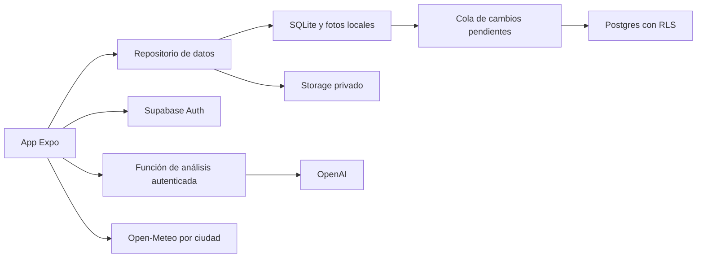

# Plan de cuentas y datos

23/10/2026 · Propuesta, sin implementación ni recursos contratados. El prototipo sigue usando almacenamiento local v3. Esta propuesta no sustituye el [ADR-002](adr/0002-persistencia-local.md).

## Objetivo

Recuperar el clóset al cambiar de teléfono y usarlo en dos dispositivos. Crear una cuenta debe ser opcional para registrar ropa y armar conjuntos. Una caída de red no debe impedir consultar o editar las prendas descargadas.

## Arquitectura propuesta

**Expo + Supabase Auth, Postgres y Storage privado.** Mantener el recomendador en el teléfono. Añadir una función autenticada para el análisis de fotos cuando se habilite el servicio público.

| Decisión propuesta | Motivo | Costo o alternativa |
|---|---|---|
| Supabase para identidad, filas y fotos | Reduce los servicios que debe operar una sola persona; el modelo de prendas, conjuntos y usos encaja en Postgres. | Requiere políticas de acceso, restauración y límites. Firebase también es viable, pero no necesitamos adoptar otro modelo de datos para este caso. |
| Código por correo para la primera cuenta | Evita contraseñas propias y permite completar el acceso dentro de la app. | Depende de entrega de correo, límites y protección de abuso. Apple/Google pueden añadirse después si reducen fricción. |
| SQLite antes de sincronizar ediciones | Permite guardar cada cambio y su operación pendiente en una misma transacción. | Añade migraciones y resolución de conflictos. El JSON actual sigue siendo suficiente mientras el producto sea local. |
| Fotos privadas separadas de las filas | Evita repetir imágenes dentro de cada conjunto guardado y permite reintentar cargas. | Hay que coordinar carga, borrado y respaldo de objetos con los datos. |
| Reglas de conjuntos en el dispositivo | Conserva el funcionamiento sin red y la explicación de restricciones. | Cambiar reglas requiere actualizar la app; no necesita un servidor de recomendaciones en esta fase. |

La propuesta se apoya en [Auth para React Native](https://supabase.com/docs/guides/auth/quickstarts/react-native), [RLS](https://supabase.com/docs/guides/database/postgres/row-level-security) y [acceso a Storage](https://supabase.com/docs/guides/storage/security/access-control). La sincronización descrita aquí debe construirse: Supabase no sustituye la cola local ni resuelve por sí mismo los conflictos del producto.

## Acceso y sesión

1. Mantener **Continuar sin cuenta**. Ofrecer **Respaldar mi clóset** desde Mi estilo, después de que haya algo que guardar.
2. Solicitar correo; enviar un código y verificarlo. Configurar la plantilla con `{{ .Token }}`: `signInWithOtp` envía un enlace por defecto si no se cambia la plantilla. Probar expiración, reenvío, límites y códigos incorrectos. [OTP por correo](https://supabase.com/docs/guides/auth/auth-email-passwordless).
3. Configurar SMTP de producción con dominio verificado y probar entrega antes del piloto. No depender del correo de prueba del proveedor. [SMTP de Supabase](https://supabase.com/docs/guides/auth/auth-smtp).
4. Para móvil, implementar un adaptador de sesión sobre SecureStore y probar tamaños reales, escritura incompleta, renovación y borrado. No meter tokens en el JSON del clóset ni en registros. SecureStore puede rechazar valores grandes y, en iOS, conservar valores tras reinstalar: contemplar ambas situaciones. [SecureStore](https://docs.expo.dev/versions/v55.0.0/sdk/securestore/).
5. Renovar la sesión en primer plano y detener la renovación en segundo plano. Si caduca, conservar cambios locales del propietario y pausar las subidas hasta autenticar de nuevo. Registrar un solo observador de AppState y liberar suscripciones.
6. Al salir, detener y cancelar peticiones del usuario anterior, retirar credenciales y cerrar su almacén local. No mostrar sus fotos o datos al invitado o a otra cuenta. Si hay cambios sin subir, ofrecer sincronizarlos primero o conservarlos aislados para esa misma cuenta; nunca reasignarlos automáticamente.

Si se añade Google u otro acceso social, revisar la regla 4.8 de Apple y ofrecer Sign in with Apple cuando corresponda. Para OAuth usar una build propia con identificadores y redirecciones registradas, PKCE y verificación de estado; Expo Go no será el entorno de aceptación de ese flujo. [Reglas de Apple](https://developer.apple.com/app-store/review/guidelines/#login-services).

## Modelo de datos inicial

Esquema conceptual, todavía sin SQL ni migraciones:

| Entidad | Datos y restricciones |
|---|---|
| `profiles` | `user_id` asociado a Auth, nombre opcional y versión. No copiar credenciales. |
| `preferences` | `user_id`, estilos, colores preferidos/excluidos, rotación, contexto manual y ciudad elegida. Tema, vista y vibración permanecen por dispositivo al inicio. La caché meteorológica no se sincroniza. |
| `wardrobe_items` | UUID, `user_id`, atributos confirmados, disponibilidad, `photo_id`, versión y marca de borrado. |
| `photos` | UUID, `user_id`, clave de objeto, MIME, tamaño y estado de carga. No almacenar una URL firmada como identificador. |
| `outfits` / `outfit_items` | UUID, `user_id`, referencias a prendas e instantánea de atributos al guardar. No duplicar archivos de fotos. Revalidar disponibilidad al registrar uso. |
| `wear_events` | UUID de evento, `user_id`, prendas, instante y día local. Clave de idempotencia y restricción de unicidad del conjunto/día según la regla actual. |
| `import_batches` | `user_id`, instalación de origen, identificador de lote y estado para reanudar importaciones sin duplicar. |

Toda referencia entre entidades debe verificar también el propietario: una FK que solo comprueba el UUID no basta para impedir referencias cruzadas. Contadores y última fecha de uso se derivan de eventos o se actualizan en la misma transacción; no sumar un contador de manera independiente desde cada teléfono.

## Propiedad y fotos

- Habilitar RLS en todas las tablas expuestas. Leer y borrar solo donde `auth.uid() = user_id`; insertar con `WITH CHECK`; actualizar con `USING` y `WITH CHECK`, además de la política SELECT correspondiente. No usar metadatos editables de usuario para autorizar.
- Las operaciones privilegiadas derivan el usuario de una sesión verificada; ignoran cualquier propietario enviado en el cuerpo. La app solo incluye URL y clave publicable. Las claves secretas y `service_role` permanecen en servidor.
- Bucket privado y rutas `userId/photoId.jpg`. Políticas por propietario para lectura, subida y borrado; usar rutas nuevas al reemplazar imágenes. Si se usa upsert, probar también SELECT/UPDATE. Servir por descarga autenticada o URL firmada breve; no poner URLs firmadas en logs.
- Reducir imagen y retirar metadatos innecesarios antes de subir; validar MIME, firma, tamaño y propiedad en servidor. Sin reconocimiento facial ni inferencias de identidad.
- “Analizar foto” sigue siendo una acción explícita. Puede enviar una foto temporal sin añadirla primero al clóset cloud. La respuesta vuelve al formulario de revisión; nunca inserta una prenda por su cuenta.

## Migración sin perder el clóset actual

1. Leer y validar v3 con el código existente; crear una copia recuperable antes de migrar. Conservar fotos y referencias, incluso si alguna no puede leerse.
2. Crear un almacén local por instalación invitada; conservar identificadores originales en un mapa hacia UUIDs. No regenerar el mapa al reintentar.
3. Después del acceso, mostrar número de prendas/fotos y pedir **Importar este clóset**. Excluir la demo por defecto; mantener los datos locales hasta terminar.
4. Si la cuenta ya tiene datos, ofrecer importar como prendas nuevas o conservar el clóset de la cuenta. No deduplicar por nombre ni sobrescribir una nube existente silenciosamente.
5. Importar por lote idempotente. Subir fotos con rutas deterministas, verificar objetos y confirmar relaciones antes de marcar el lote completo. Una carga fallida queda pendiente, no convertida en una prenda sin foto.
6. Comprobar prendas, fotos, guardados y usos en una segunda instalación. No eliminar la copia anterior hasta confirmar la recuperación y la política de conservación.

## Sincronización y conflictos

Guardar localmente la entidad y la operación pendiente en una sola transacción. Cada operación tendrá UUID, propietario, versión base y carga validada. Enviar por entidad en orden, con reintentos y espera progresiva; reintentar una operación no debe aplicarla dos veces.

El servidor devuelve la nueva versión. Si la versión base quedó atrás, conservar ambas revisiones y mostrar el conflicto para resolverlo; no sobrescribir por hora del teléfono. La primera versión puede usar conflicto por prenda completa para reducir complejidad. El reloj y las revisiones autoritativas son del servidor.

Los borrados dejan una marca que llega a los otros dispositivos. Recuperar cambios por cursor del servidor, no solo por `updated_at` del cliente. Al volver de segundo plano o recuperar red, reanudar la cola del usuario autenticado. Mostrar **Guardado en este teléfono**, **Pendiente de subir** o **Respaldado** según evidencia; guardar localmente no significa estar respaldado.

## Borrado y recuperación

Ofrecer eliminación de cuenta dentro de la app y una vía web. Verificar nuevamente la identidad, bloquear nuevas operaciones, revocar sesiones y ejecutar una eliminación reintentable de fotos, filas y cuenta. El bloqueo del lado servidor debe impedir operaciones con un JWT anterior todavía vigente. Documentar plazo y tratamiento de copias de seguridad antes de publicar.

Probar restauración de base de datos y archivos por separado: una copia de Postgres no equivale a una copia de los objetos de Storage. Definir un objetivo inicial de recuperación de hasta 24 horas de datos y medir un simulacro antes del piloto; no prometerlo hasta comprobarlo. [Backups de Supabase](https://supabase.com/docs/guides/platform/backups).

## Orden de implementación y aceptación

1. **Repositorio local y migración a SQLite:** v1/v2/v3, clóset vacío, fotos, cierre durante migración y recuperación intactos.
2. **Identidad y aislamiento:** acceso, renovación, salida y cambio de cuenta; tests RLS con dos usuarios y sin sesión, incluidos objetos y referencias ajenas.
3. **Respaldo e importación:** interrupción de red, reintento del mismo lote, restauración en otro teléfono y foto no disponible sin perder el original.
4. **Sincronización:** editar la misma prenda en dos teléfonos; conflicto visible, borrado propagado y uso idempotente.
5. **IA pública:** token verificado, cuota por usuario, límite global de gasto, imagen inválida, timeout y alternativa manual. Adaptar el servidor Node actual al handler del alojamiento elegido y comprobarlo allí.
6. **Piloto:** eliminación de cuenta completa, recuperación de backup, prueba de permisos y navegación accesible en dispositivos reales.

No añadir un ORM, microservicios ni sincronización en tiempo real antes de necesitarlo. Convertir esta propuesta en un ADR aceptado cuando se acuerde e implemente el primer alcance cloud.
